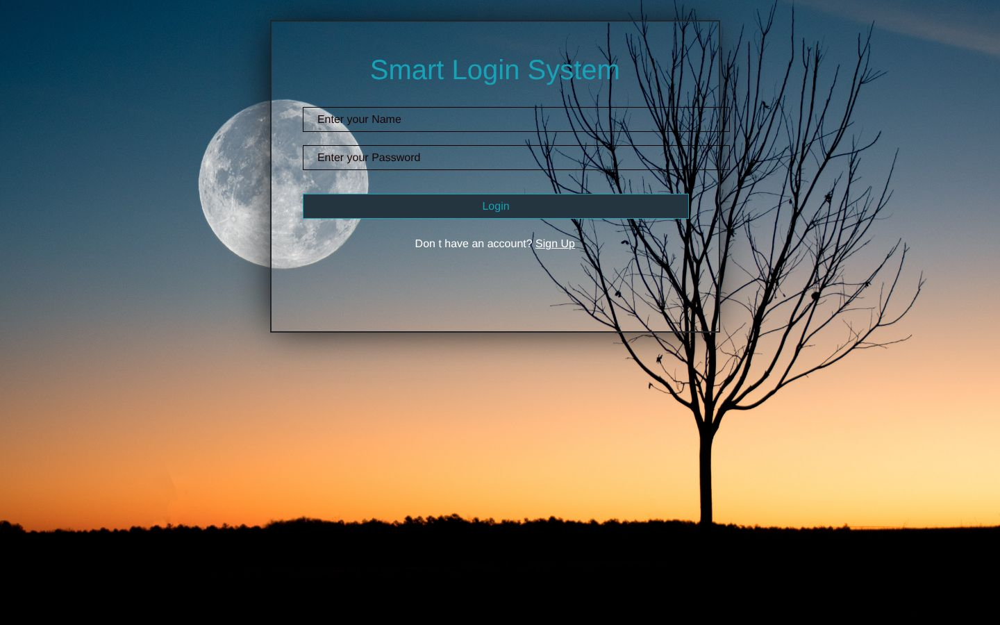
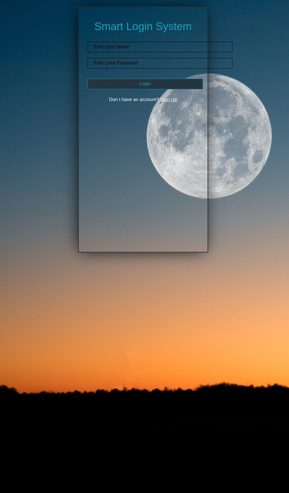
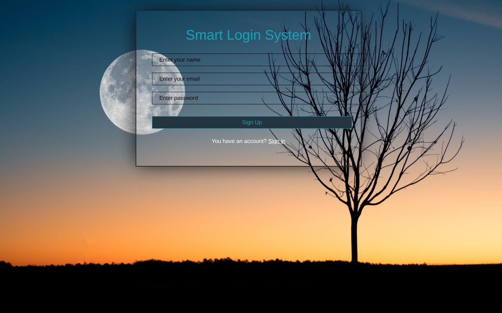

<div align="center">

# Smart Login

### Sign-up, login and welcome pages backed by the browser's localStorage

A three-page login flow in vanilla JavaScript, from my 2022 front-end training. You create an account on the sign-up page, log in with the same name and password, and get redirected to a welcome page with a log-out link.

[](https://developer.mozilla.org/docs/Web/HTML)
[](https://developer.mozilla.org/docs/Web/CSS)
[](https://developer.mozilla.org/docs/Web/JavaScript)
[](https://getbootstrap.com)
<br>
[](https://eslamraafat1.github.io/Smart-Login/)

**[Live demo](https://eslamraafat1.github.io/Smart-Login/)** ·
**[Portfolio](https://new-portfolio-ashy-xi.vercel.app/)** ·
**[LinkedIn](https://www.linkedin.com/in/eslamraafat-dev/)** ·
**[Email](mailto:eslamraafat736@gmail.com)**

<br>



</div>

<table>
  <tr>
    <td width="40%"></td>
    <td width="60%"></td>
  </tr>
  <tr>
    <td align="center"><sub>Mobile (iPhone 13)</sub></td>
    <td align="center"><sub>Sign-up page (<code>sign.html</code>)</sub></td>
  </tr>
</table>

---

## Overview

A **learning project** from my 2022 front-end course (the "Smart Login" task). It is front-end only: "accounts" are saved in the visitor's own browser with `localStorage`, so it shows how a login flow is wired, not how to secure one.

What I practised:

- Reading form values and storing objects with `JSON.stringify` / `JSON.parse`
- Branching on lookup results (unknown user, wrong password, success)
- Navigating between pages with `window.location.href`

## Features

- **Sign up** (`sign.html`): saves `{ username, email, password }` to `localStorage` under the username and shows a success alert.
- **Log in** (`index.html`): looks the username up, compares the password and alerts **wrong username** or **wrong password** when they don't match.
- **Welcome page** (`index2.html`): shown after a successful login, with a **Log Out** link back to the login page.
- Glass-style card over a full-page photo background.

> [!NOTE]
> Passwords are stored in plain text in `localStorage`. That's fine for a classroom demo, but don't reuse a real password on it.

## Pages

| Page | File | What it does |
| --- | --- | --- |
| Login | `index.html` | Name + password, link to sign up |
| Sign up | `sign.html` | Name + email + password, link back to login |
| Welcome | `index2.html` | Success message and log-out link |

## Tech stack

| Layer | Tools |
| --- | --- |
| Markup and styles | HTML5, CSS3, Bootstrap 5.2 (local copy) |
| Scripting | Vanilla JavaScript, Web Storage API (`localStorage`) |
| Icons | Font Awesome Free 6.1.2 (local copy, linked) |
| Hosting | GitHub Pages |

## Project structure

```text
.
├── index.html · sign.html · index2.html   # login, sign-up, welcome
├── style.js                               # signup(), loginFunc(), logOut()
├── style.css
├── bootstrap.min.css · bootstrap.bundle.min.js
├── font/ · webfonts/                      # Font Awesome
├── pexels-david-besh-884788.jpg           # background photo
└── docs/screenshots/                      # README images
```

## Getting started

No build step. Open `sign.html` in a browser to create an account, or serve the folder:

```bash
git clone https://github.com/Eslamraafat1/Smart-Login.git
cd Smart-Login
npx serve .          # http://localhost:3000
```

## Deployment

Hosted on **GitHub Pages** from the `master` branch: **https://eslamraafat1.github.io/Smart-Login/**

## Author

**Eslam Raafat**, Front-End Developer (React · Next.js · TypeScript)

- **Portfolio:** [new-portfolio-ashy-xi.vercel.app](https://new-portfolio-ashy-xi.vercel.app/)
- **LinkedIn:** [linkedin.com/in/eslamraafat-dev](https://www.linkedin.com/in/eslamraafat-dev/)
- **GitHub:** [@Eslamraafat1](https://github.com/Eslamraafat1)
- **Email:** [eslamraafat736@gmail.com](mailto:eslamraafat736@gmail.com)
